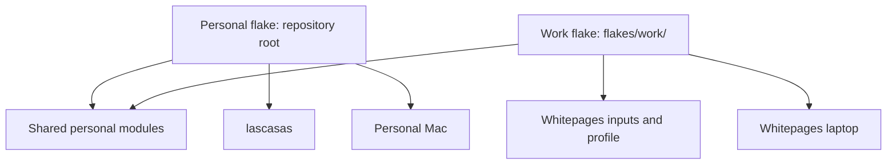

# Shared personal configuration, separate work dependencies

## Approval surface

**Decision:** One repository contains a public-input personal flake at the root and a private-input entry point under `flakes/work/`. Machine-specific configuration for both operating systems lives under `hosts/<hostname>/`; entry points supply dependencies and select modules. They share personal modules, not company dependencies or necessarily package pins.

**Decision:** Whitepages configuration belongs only on `wp-K942Q6VXR7`. Neither lascasas nor the personal Mac imports the work profile or requires company-repository access to rebuild.

**Working agreement:** Edit this jj checkout directly, without a managed stack. Planning does not change the existing dirty `flake.lock`. No commits, system activation, reboot, or unrelated tooling repair is implicit approval.

## Narrative

Eric opens his personal Mac after the work VPN disconnects. An agent on lascasas needs the same Helix bindings and shell tools he uses locally. He rebuilds lascasas from his personal configuration, but an input tries to read `/Users/emerritt/workspace/monorepo-stacks/stacks/stack-herdr`. That directory exists only on the work laptop.

“Sharing my editor shouldn't require my employer's checkout,” he says. He selects the personal flake, which resolves public inputs and builds the Linux host. Later, on the work laptop, he selects the work flake: the same editor preferences are composed with company tools and identity. If a work input cannot be fetched, that build fails explicitly; it neither blocks the personal machines nor silently substitutes a different revision.

## Problem and planning baseline

- The current root flake exports only the work laptop's Darwin configuration. Its nixpkgs, nix-darwin, and Home Manager inputs follow `whitepages-nix`.
- Both private inputs use absolute `git+file` URLs into the work laptop's stack checkout. The current lock pins that source at `e09fe7b702e72c1aeebc09375b2f916bb16b6180`.
- `nix-home/common.nix` contains personal preferences alongside Homebrew paths, Determinate netrc handling, Colima SSH configuration, a macOS activation command, and work Git/JJ identity.
- The WezTerm module supplies personal configuration but relies on the work profile to enable WezTerm. Zellij requires the locally defined attention-plugin overlay.
- `nix-home/r630.nix` is an unused Home Manager wrapper, not a Linux system configuration. Its old state version is not evidence of an existing Home Manager installation on the freshly installed server.
- Lascasas currently runs a minimal NixOS installation without Home Manager. Its working configuration is in `/etc/nixos`, outside this repository.
- Baseline validation: formatting passes; `just validate` fails on Statix's existing repeated-`home`-key warning in `nix-home/common.nix`. Direnv also reports a missing `.env`; neither issue is introduced by this spec.

## Boundaries and module ownership

A **shared personal module** contains preferences or public tools Eric wants on multiple machines. It is not an alias for the work profile or a demand to install every application everywhere.

A **platform module** owns operating-system integration. A **host module** owns machine identity, users, hardware, and services. A **work module** owns company-specific packages, identity, credentials integration, and agent policies.

Target ownership:

| Area | Owner |
|---|---|
| Helix, shell preferences, Git/JJ behavior, terminal multiplexer | Shared personal Home Manager modules |
| Public agent executables and personal settings | Personal modules; company extensions/policies remain work-only |
| GUI applications | Explicit desktop modules, not the headless server default |
| Homebrew, Colima, macOS activation commands | Darwin modules, with app-specific actions enabled only where needed |
| Determinate-specific Nix ownership/netrc behavior | Hosts using Determinate, not every Darwin or personal host |
| Work Git/JJ identity, enterprise SSH entries, company caches and tools | Work composition |
| Filesystems, PERC initrd driver, bootloader, server SSH and authorized key | Lascasas host modules |
| Zellij attention plugin | Public shared overlay, applied explicitly to consumers |
| Existing package workarounds | Preserve on their current consumers; do not apply globally without a reason |

Prefer ordinary modules and explicit imports over a configurable host-generation framework. Hostnames, usernames, home paths, and identity are supplied at the host/profile boundary rather than assumed by shared modules.

**Confirmed personal identity:** Git and JJ use `Eric Merritt <eric@merritt.tech>` on personal hosts. The work laptop keeps its work identity.

## Flake and dependency contracts

1. The personal flake exports `nixosConfigurations.lascasas`, reusable personal Home Manager modules, and a personal Darwin output once that host's facts are confirmed. Its entire input graph uses public sources; no company URLs, absolute checkout inputs, or dependence on `flakes/work/flake.lock`.
2. The work flake retains `darwinConfigurations."wp-K942Q6VXR7"` and its coordinated company pins. Only its graph includes Whitepages inputs. It has its own lock file.
3. The work flake consumes shared modules through the repository's personal flake/module boundary, using a supported repository-relative reference. Both entry points must work from a GitHub-fetched revision on the installed Nix versions, not just from the current working directory.
4. Tracked dependency references are portable. Temporary local development inputs use explicit overrides. Do not replace the current work revision with remote `main` until availability and intended differences have been checked.
5. Lascasas initially stays on NixOS 26.05 with a compatible public Home Manager pin. Adding sharing is not permission to upgrade its system packages to the work laptop's release.
6. Shared modules must evaluate against both selected Home Manager versions. Verify option and package availability; isolate version/platform differences rather than assuming the work pin's API exists on the stable Linux pin.

## Host preservation and intended changes

| Host | Preserve | Intended change |
|---|---|---|
| Whitepages laptop | Current checked-out package pins, work profile, personal behavior, username/home, Darwin state version 4, Home Manager state version 23.05, existing Nix ownership | Select the separate work entry point |
| Lascasas | Root/EFI UUIDs, GPT/UEFI boot, `megaraid_sas`, microcode, DHCP, hostname/user, password state, key-only SSH, authorized key, power-meter blacklist, system state version 26.05 | Enable the separately approved NixOS user SSH agent; later gain the shared personal development environment and fresh Home Manager state version 26.05 |
| Personal Mac | Existing hardware/user/Nix ownership and state versions, once inspected | Personal configuration without work composition |

Capture the work laptop's evaluated checkout baseline and its running generation separately: any existing deployment drift must not be mislabeled as a refactor regression. Preserve lascasas's current successful generation as rollback.

Adopting the shared shell on Linux is an intentional behavior change, not an upgrade prerequisite. Any login-shell change must be visible in the activation review. Do not reinstall disks, reset passwords, replace host keys, or copy credentials into the Nix store.

## Validation and rollout

- Extend the existing Justfile with distinct evaluation/build checks for the personal root and work entry point. Test instantiated configurations, not merely exported module names.
- Inspect the personal lock graph and archive/evaluate its inputs without company access or local overrides. A successful cached evaluation alone does not establish dependency independence.
- Build Linux on lascasas and Darwin on the appropriate Mac. Keep cross-platform evaluation separate from native build claims.
- Assert the company-only identity, tools, cache/auth configuration, and activation jobs are absent from personal outputs. Account for public tools that are legitimately shared rather than banning a package solely because the work profile also installs it.
- Assert the preservation table against evaluated configurations; compare the Mac's package/settings/activation baseline and explain any difference before activation.
- Publish a named jj bookmark and test both entry points from the GitHub-fetched revision to catch relative-input, missing-source-file, and lock portability failures. Use normal jj clone/fetch workflows on each machine rather than custom source-export or SSH-copy helpers. Keep ignored secrets and build artifacts out of the published source. Record the host-selection commands in a short README.
- Build before activation. Review Home Manager's dry run and unmanaged-file collisions; back up conflicts rather than silently forcing replacement. Activate one host at a time with user approval, then verify fresh SSH, user shell/editor, Nix builds, and failed units. Avoid simultaneous changes to both access paths.
- Lock-file restructuring requires a separately reviewed change: preserve the current user-owned lock/diff as the baseline and identify which pins moved versus changed. Never run an indiscriminate update as part of this refactor.

## Non-goals

No changes to the Whitepages repository, stack registries, jj installations, server firmware, RAID, or storage layout. No secret management redesign, new container runtime, workload tuning, or broad editor/terminal cleanup. Do not move company agent policies into the personal profile to make an executable available.

## Implementation checkpoint

The phase-1 split is implemented: root personal inputs and `flakes/work/` have separate locks, both machines have modules under `hosts/`, and the work configuration passes its captured baseline assertions. Personal validation, earlier fresh-copy evaluation of both entry points, and a native Linux build have passed. The temporary snapshot helpers have been removed in favor of normal GitHub publication and jj checkouts; publication of the WIP bookmark is explicitly approved. Running generations have not been activated by this work.

**Remaining phase-1 gate:** The native Mac build has repeatedly been interrupted while building the existing `stack-workbench` package. No compiler/build error was reported, but the full build has not passed. Keep the phase incomplete until `just build-work-mac` finishes; do not start activation or call this runtime-verified sharing. Personal Home Manager adoption remains phase 2.

**Approved Linux addition:** Manage the user SSH agent with `programs.ssh.startAgent`, using NixOS's runtime socket rather than a manual agent process. Private keys and passphrases stay outside the repository and Nix store; unlocking remains interactive after agent restart. Activation still requires separate approval.

## Open questions and gates

- **Eric, before personal-Mac onboarding:** Provide its hostname, login/home path, existing configuration/state versions, and Nix installation/ownership. Do not invent a host or copy the work laptop's identifiers.
- **Work-source preflight resolved:** The local work commit has a published rebased counterpart, `9643e6f90942034b46240cf288dbbe482cd8770c`, which Nix successfully fetched over SSH. Both private inputs now pin that commit. The compared work-profile, Stack, and Pi source trees match the baseline; Pagecraft has rebase-related source differences. Evaluated upstream pins, package names/versions, host/user settings, managed filenames, and activation job names match; this is not a claim of runtime equivalence. Published `main` was rejected because it removes native Stack integration.
- **Approved lock migration:** Preserve the existing work pins under `flakes/work/flake.lock` and generate a separate public-input root lock, without an intentional work-laptop upgrade. The split is now implemented. Existing work pins remain unchanged; the work graph adds a relative personal input and its independent public pin. The original dirty lock and evaluated baseline were saved under `/tmp/nix-darwin-input-audit/` before changes.

## References

- [Nix flake references and input semantics](https://nix.dev/manual/nix/2.34/command-ref/new-cli/nix3-flake.html)
- [Home Manager manual](https://nix-community.github.io/home-manager/)
